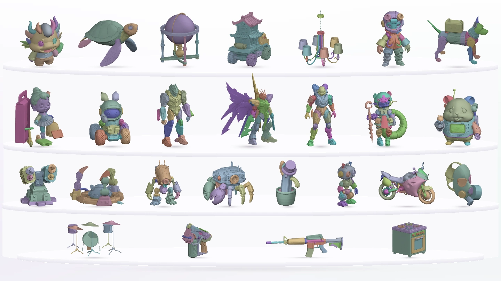
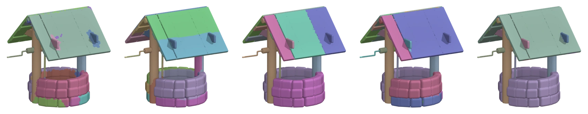
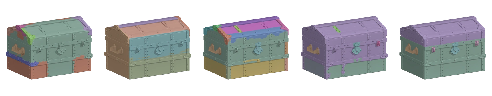

# 🤖 PartAgent: Agentic 3D Part Segmentation via Expert Integration and Closed-Loop Refinement

⭐ If you find PartAgent interesting, please consider starring this repository. Thank you!

> [Yang Cao](https://yangcaoai.github.io/)<sup>1</sup>, [Zhe Zhu](https://czvvd.github.io/homepage/)<sup>2</sup>, [Yiheng Zhang](https://graphic-kiliani.github.io/homepage/)<sup>1</sup>, [Zhengqiang Zhang](https://xtudbxk.github.io/)<sup>3</sup>, [Haoyuan Li](https://scholar.google.com/citations?user=ccgdLGsAAAAJ)<sup>4</sup>, [Le Wan](https://openreview.net/profile?id=~Le_Wan1)<sup>2</sup>, [Dan Xu](https://www.danxurgb.net/)<sup>1,*</sup>
>
> <sup>1</sup> Hong Kong University of Science and Technology<br>
> <sup>2</sup> Tencent
> <sup>3</sup> Hong Kong Polytechnic University<br>
> <sup>4</sup> Sun Yat-sen University

**[📄 Paper](https://arxiv.org/pdf/2611.32554) · [🌐 Project Page](https://yangcaoai.github.io/PartAgent_ProjectPage/)**

[](https://yangcaoai.github.io/PartAgent_ProjectPage/#showcase)

## 🚩 Updates

- The [paper](https://arxiv.org/pdf/2611.32554) is available on arXiv. Demos are shown in [project page](https://yangcaoai.github.io/PartAgent_ProjectPage/)
- The code has not yet been released. Please stay tuned for updates.

## Framework

1. **Structural–Semantic Expert Integration (SSEI)** combines regions predicted by the 3D expert with multiview semantic evidence from the 2D expert through image-to-surface correspondences, constructing compositional part partitions at multiple granularities.
2. **Observation-Driven Closed-Loop Partition Refinement (CLR)** observes the current partition and its supporting evidence to select targeted inspection, evidence repair, composition, or reselection actions. It verifies proposed changes and uses the updated state and action outcomes to guide subsequent decisions. 


## Results

PartAgent achieves the highest **Mask Match mIoU** among the compared methods on all five benchmarks.

| PartObjaverse-Tiny-WT | 3DCoMPaT200 | PartNeXt | PartNetE | PartObjaverse-Tiny |
|:---:|:---:|:---:|:---:|:---:|
| 68.41 | 67.82 | 72.42 | 71.43 | 65.76 |

On PartObjaverse-Tiny-WT, PartAgent leads the strongest competing method by **8.53 points**. Across the other four datasets, its mean of **69.36** exceeds the best competing method’s mean of **62.08** by **7.28 points**. [Full benchmark tables](https://yangcaoai.github.io/PartAgent_ProjectPage/#results)

The rows show a decorative fish, a water well, and a wooden chest, each viewed from the same angle across methods. From left to right, the methods are **SAMPart3D**, **PartField**, **P3-SAM**, **PartSAM**, and **PartAgent**.

[](https://yangcaoai.github.io/PartAgent_ProjectPage/#comparisons)

[](https://yangcaoai.github.io/PartAgent_ProjectPage/#comparisons)

[](https://yangcaoai.github.io/PartAgent_ProjectPage/#comparisons)

## 📜 BibTeX

```bibtex
@article{cao2026partagent,
  title = {PartAgent: Agentic 3D Part Segmentation via Expert Integration and Closed-Loop Refinement},
  author = {Cao, Yang and Zhu, Zhe and Zhang, Yiheng and
            Zhang, Zhengqiang and Li, Haoyuan and Wan, Le and Xu, Dan},
  journal = {arXiv preprint arXiv:2611.32554},
  year = {2026}
}
```

## 📧 Contact

For questions, please contact [Yang Cao](mailto:yangcao.cs@gmail.com).

## 📜 Sincere Acknowledgement

We sincerely thank the authors of the following projects for sharing their research and resources with the community:

[P3-SAM](https://murcherful.github.io/P3-SAM/), [Part-SAM](https://github.com/czvvd/PartSAM) [PartField](https://github.com/nv-tlabs/PartField), [SAMPart3D](https://github.com/Pointcept/SAMPart3D), [Find3D](https://github.com/ziqi-ma/Find3D), etc
