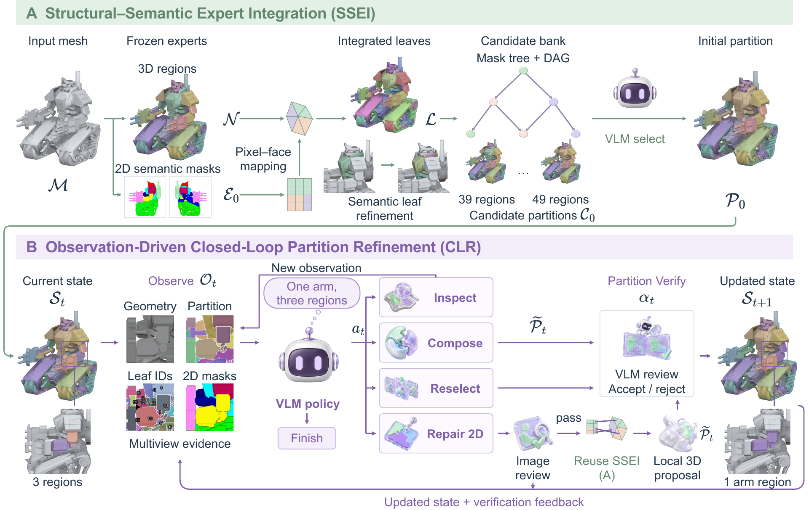
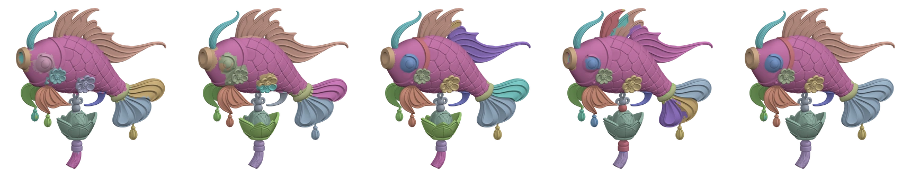

# 🤖 PartAgent: Agentic 3D Part Segmentation via Expert Integration and Closed-Loop Refinement

> [Yang Cao](https://yangcaoai.github.io/)<sup>1</sup>, [Zhe Zhu](https://czvvd.github.io/homepage/)<sup>2</sup>, [Yiheng Zhang](https://graphic-kiliani.github.io/homepage/)<sup>1</sup>, [Zhengqiang Zhang](https://xtudbxk.github.io/)<sup>3</sup>, [Haoyuan Li](https://scholar.google.com/citations?user=ccgdLGsAAAAJ)<sup>4</sup>, [Le Wan](https://openreview.net/profile?id=~Le_Wan1)<sup>2</sup>, [Dan Xu](https://www.danxurgb.net/)<sup>1,*</sup>
>
> <sup>1</sup> Hong Kong University of Science and Technology · <sup>2</sup> Tencent · <sup>3</sup> Hong Kong Polytechnic University · <sup>4</sup> Sun Yat-sen University<br>
> <sup>*</sup> Corresponding author

**[📄 Paper](https://arxiv.org/pdf/2611.32554) · [🌐 Project Page](https://yangcaoai.github.io/PartAgent_ProjectPage/)**

**PartAgent** is a training-free framework that combines frozen 3D and 2D experts to segment an object into meaningful parts. It builds an initial segmentation, inspects it from multiple views, and decides what to revise.

[](https://yangcaoai.github.io/PartAgent_ProjectPage/#showcase)

## Updates

The [paper](https://arxiv.org/abs/2611.32554) is available on arXiv. You can [watch the 30-second showcase](https://yangcaoai.github.io/PartAgent_ProjectPage/#showcase) or [rotate 12 segmented objects in 3D](https://yangcaoai.github.io/PartAgent_ProjectPage/#interactive). The implementation has not yet been released.

## Motivation

A tractor’s rear wheel illustrates the challenge. A segmentation can split the wheel into two regions while grouping its fender with part of the tire. A 2D expert can help identify these parts in individual views. PartAgent maps that evidence onto the mesh, then checks whether the regions have been grouped correctly.

## Framework

1. **Structural–Semantic Expert Integration (SSEI)** maps multiview semantic predictions from the 2D expert onto the mesh through image-to-surface correspondences. It uses them to refine the 3D expert’s regions and group them into candidate segmentations at multiple granularities.
2. **Observation-Driven Closed-Loop Partition Refinement (CLR)** uses a vision–language model to inspect the current segmentation and its supporting evidence. The agent can inspect a region more closely, repair a 2D mask, regroup 3D regions, or select another candidate. It verifies proposed changes and uses the outcome to guide its next decision.



In the [tractor walkthrough](https://yangcaoai.github.io/PartAgent_ProjectPage/#method), the agent inspects the rear wheel, separates the fender from the tire, and regroups the two regions belonging to the wheel. After verifying the change across views, it turns to the exhaust for its next inspection.

## Results

PartAgent achieves the highest **Mask Match mIoU** among the compared methods on all five benchmarks.

| PartObjaverse-Tiny-WT | 3DCoMPaT200 | PartNeXt | PartNetE | PartObjaverse-Tiny |
|:---:|:---:|:---:|:---:|:---:|
| 68.41 | 67.82 | 72.42 | 71.43 | 65.76 |

On PartObjaverse-Tiny-WT, PartAgent leads the strongest competing method by **8.53 points**. Across the other four datasets, its mean of **69.36** exceeds the best competing method’s mean of **62.08** by **7.28 points**. [Full benchmark tables](https://yangcaoai.github.io/PartAgent_ProjectPage/#results)

On the decorative fish below, PartAgent keeps the dorsal fin and the tail fin as one part each. From left to right, the methods are **SAMPart3D**, **PartField**, **P3-SAM**, **PartSAM**, and **PartAgent**.

[](https://yangcaoai.github.io/PartAgent_ProjectPage/#comparisons)

## BibTeX

```bibtex
@article{cao2026partagent,
  title = {PartAgent: Agentic 3D Part Segmentation via Expert Integration and Closed-Loop Refinement},
  author = {Cao, Yang and Zhu, Zhe and Zhang, Yiheng and
            Zhang, Zhengqiang and Li, Haoyuan and Wan, Le and Xu, Dan},
  journal = {arXiv preprint arXiv:2611.32554},
  year = {2026}
}
```
